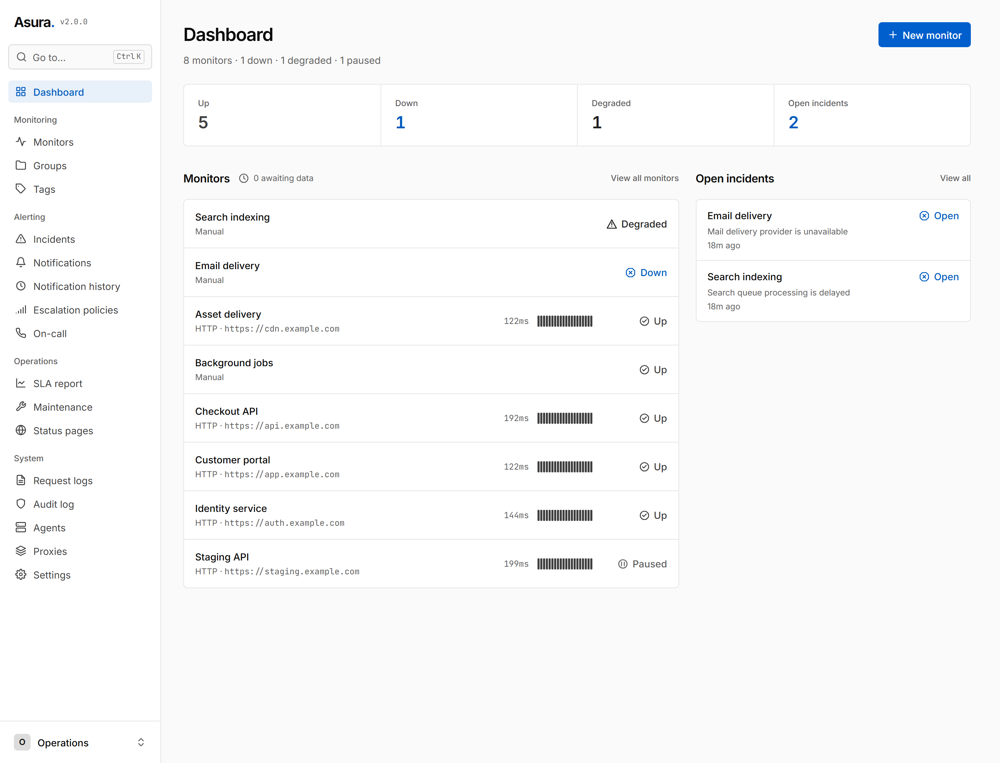
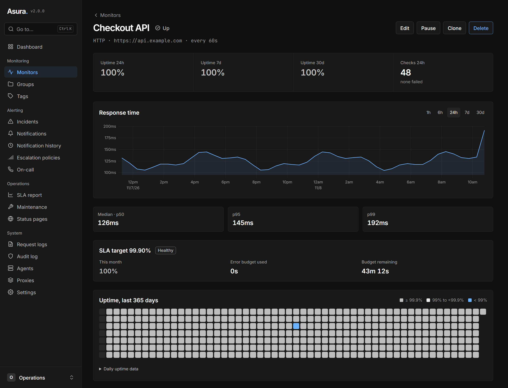
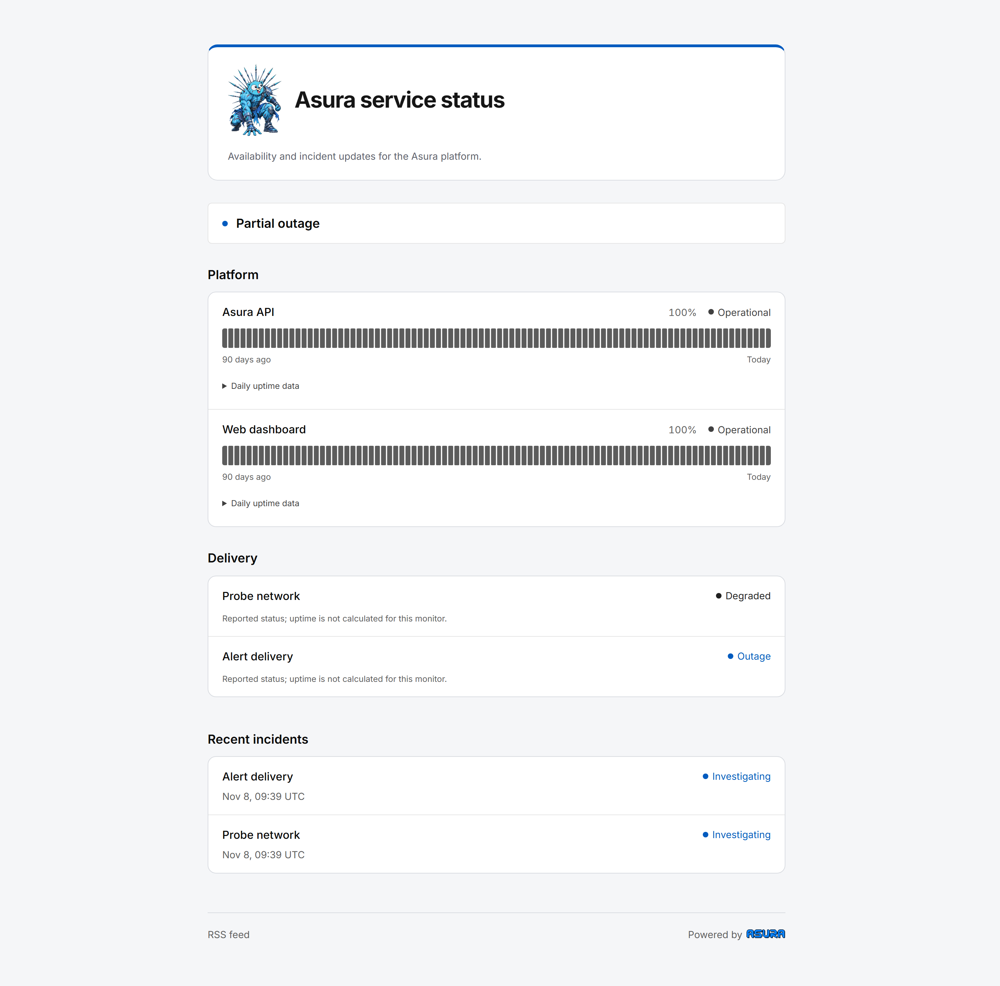

<p align="center">
  
</p>
<h1 align="center">Asura</h1>
<p align="center">
  Self-hosted uptime monitoring and status pages.
</p>
<p align="center">
  <a href="https://github.com/y0f/asura/actions/workflows/ci.yml"></a>
  <a href="https://github.com/y0f/asura/stargazers"></a>
  <a href="https://github.com/y0f/asura/blob/main/go.mod"></a>
  <a href="LICENSE"></a>
  <a href="https://github.com/y0f/asura/releases/latest"></a>
  <a href="https://github.com/y0f/asura/pkgs/container/asura"></a>
</p>
<p align="center">
  <a href="https://y0f.github.io/asura/">Documentation</a> &middot;
  <a href="https://y0f.github.io/asura/getting-started.html">Quick start</a> &middot;
  <a href="https://y0f.github.io/asura/api.html">API</a> &middot;
  <a href="https://y0f.github.io/asura/upgrading.html">Upgrading</a> &middot;
  <a href="CONTRIBUTING.md">Contributing</a>
</p>

Asura monitors websites, APIs and network services from a single Go binary, with alerts, distributed probes and public status pages.



## Why Asura?

Benchmarked with **1,000+ monitors on a $5/month VPS**.

| Aspect | Asura | [Uptime Kuma 2.5.9](https://github.com/louislam/uptime-kuma/releases/tag/2.5.9) |
|---|---|---|
| **Install** | A single binary, Docker container or Linux service. | [Docker or Node.js/npm setup.](https://github.com/louislam/uptime-kuma/blob/2.5.9/README.md) |
| **Database** | SQLite built in; PostgreSQL available as an optional build. | [SQLite or MariaDB.](https://github.com/louislam/uptime-kuma/blob/2.5.9/server/database.js) |
| **Runtime** | Embedded web interface and assets; no Node runtime or separate frontend server. | [Node.js server with a built Vue interface.](https://github.com/louislam/uptime-kuma/blob/2.5.9/package.json) |
| **Team access** | Roles scoped by action, monitor and group. | [Single-admin setup; no scoped team roles.](https://github.com/louislam/uptime-kuma/blob/2.5.9/server/server.js#L650-L679) |
| **API** | REST API and web interface share the same scoped access controls. | [Internal Socket.IO management; HTTP push, status and metrics endpoints.](https://github.com/louislam/uptime-kuma/wiki/Internal-API) |
| **Scale** | Configurable check concurrency and distributed probes. | Server-run checks, [Globalping probes](https://github.com/louislam/uptime-kuma/blob/2.5.9/server/monitor-types/globalping.js) and push monitors. |

## Features

| Feature | Details |
|---|---|
| **Monitoring** | [19 monitor types](https://y0f.github.io/asura/monitors.html), multi-step HTTP checks, assertions, response-change detection and distributed probes. |
| **Alerting** | [13 integrations](https://y0f.github.io/asura/notifications.html): webhooks, email, Telegram, Discord, Slack, ntfy, Microsoft Teams, PagerDuty, Opsgenie, Pushover, Google Chat, Matrix and Gotify. Per-monitor routing, escalation policies and on-call schedules. |
| **Team access** | [Fine-grained roles](https://y0f.github.io/asura/access-control.html), action permissions and monitor/group scopes, with separate diagnostic access, API keys and TOTP. |
| **Custom status pages** | Your logo, favicon, header and CSS; grouped services, incident updates, RSS, email subscriptions and optional password protection. |
| **Operations** | Live dashboards, bulk actions, incident history, maintenance windows and a REST API. |
| **Reporting** | Response-time charts, monthly SLA reports and error budgets from verified probe samples. Heartbeat and manual monitors report state without sampled uptime or SLA. |

## Quick start

```bash
git clone https://github.com/y0f/asura.git
cd asura
cp config.docker.example.yaml config.yaml
docker compose build
docker compose run --rm --no-deps asura --setup
```

Save the generated **API Key** and put its **Hash** in a local `.env` file:

```dotenv
ASURA_ADMIN_KEY_HASH=your_generated_hash
```

```bash
docker compose up -d
```

Open **http://127.0.0.1:8090** and sign in with the API Key. The non-root container publishes to loopback; its database persists in the `asura-data` volume. Follow the [deployment guide](https://y0f.github.io/asura/deployment.html) for public access with HTTPS.

For Linux services, binaries or source builds, see [installation options](https://y0f.github.io/asura/getting-started.html). Download binaries from [Releases](https://github.com/y0f/asura/releases) and follow the [verification instructions](https://y0f.github.io/asura/getting-started.html#release-binaries-and-probe-agents).

## Screenshots

**Monitor detail:** response times, availability history and SLA metrics in dark mode.



**Public status page:** grouped service health, availability history and incident updates. Add your own logo, header and CSS through the [branding settings](https://y0f.github.io/asura/status-pages.html#branding).



## Upgrading

Read the [upgrade guide](https://y0f.github.io/asura/upgrading.html) and release notes before replacing an existing installation. Back up the database, configuration and encryption key together, and keep probe agents compatible with the server.

Rollback requires the previous binary and its matching database backup. A configuration export is not a database backup.

## Contributing

See [CONTRIBUTING.md](CONTRIBUTING.md) for development, tests and review requirements, [architecture](https://y0f.github.io/asura/architecture.html) for the internals, and [SECURITY.md](SECURITY.md) for reporting vulnerabilities. Built with Go, templ, HTMX, Alpine.js and Tailwind CSS; Node is not required.

Use Go 1.27.3 for development. CI tests both Go 1.27.3 and the supported minimum, Go 1.26.10.

Licensed under [MIT](LICENSE). Copyright 2025-2026 [hu.ci](https://hu.ci).
